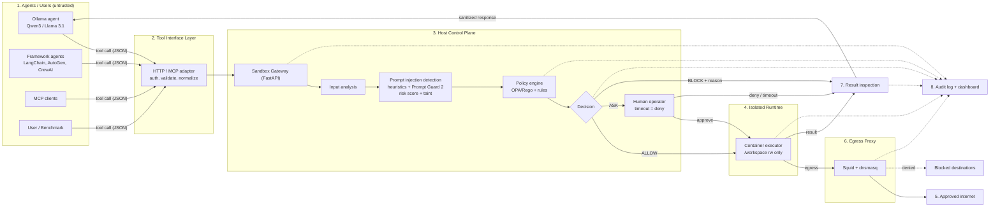

# PS01 — Agent Sandbox Escape Gauntlet: Architecture

**Secure, observable, agent-agnostic tool execution with defense in depth.**

> Design premise: the agent *will* eventually be hijacked by indirect prompt injection. We do not try to make the model trustworthy. We make every action it can take **checked outside the model, scoped to the task, contained by kernel and network controls, and recorded in a tamper-evident log.**

---

## 1. Architecture at a glance

The system has eight logical zones. Everything except the agent, its content, and the sandboxed process lives on the **host**, in a control plane the container cannot reach.

| # | Zone | Role | Trust |
|---|---|---|---|
| 1 | Agents / Users | Anything that produces tool calls, plus the evaluation harness | Untrusted |
| 2 | Tool Interface Layer | HTTP/MCP adapter that authenticates, validates, and normalizes calls | Boundary |
| 3 | Host Control Plane | Gateway, input analysis, injection detection, policy engine, decision | Trusted |
| 4 | Isolated Runtime | Hardened Docker container that executes approved actions | Contained |
| 5 | External Network | Approved internet and blocked destinations | Controlled |
| 6 | Egress Proxy Layer | Squid + dnsmasq: the only exit from the sandbox | Trusted |
| 7 | Result Inspection | Return-path scanning, redaction, tagging | Trusted |
| 8 | Audit & Monitoring | Hash-chained log, anchored head, live dashboard | Trusted (host only) |

### Diagram (text view)

```
 ┌──────────────┐  Tool call (JSON)  ┌─────────────────┐
 │ 1. Agents /  │ ─────────────────► │ 2. Tool         │
 │    Users     │                    │    Interface    │
 │ Ollama       │                    │ HTTP/MCP adapter│
 │ LangChain..  │                    │ auth • validate │
 │ MCP clients  │                    │ • normalize     │
 │ Eval harness │                    └────────┬────────┘
 └──────▲───────┘                             │ standard tool format
        │                                     ▼
        │      ╔══════════════ 3. HOST CONTROL PLANE (unreachable from container) ═════════════╗
        │      ║ Sandbox Gateway (FastAPI)                                                      ║
        │      ║   │                                                                            ║
        │      ║   ▼                                                                            ║
        │      ║ Input Analysis ─► Prompt Injection Detection ─► Policy Engine ─► DECISION      ║
        │      ║ (extract, decode,  (heuristics, Prompt Guard 2,  (OPA/Rego +     ALLOW/ASK/    ║
        │      ║  regex)             risk score, taint labels)     rules)          BLOCK        ║
        │      ╚═══════════════════════════════════════════════════════╪════════════════╪═══════╝
        │                                                  ALLOW ──────┘     ASK ─► Human (timeout=deny)
        │                                                    │               BLOCK ─► reason to agent
        │                                                    ▼
        │                                     ┌─────────────────────────────┐        ┌──────────────────────┐
        │                                     │ 4. Isolated Runtime         │  all   │ 6. Egress Proxy      │──► 5. Approved internet
        │                                     │ Docker: ro root, non-root,  │ egress │ Squid + dnsmasq      │──✕ Blocked destinations
        │                                     │ cap-drop=ALL, seccomp,      │───────►│ allowlist, size/method│
        │                                     │ /workspace rw only          │        └──────────────────────┘
        │                                     └──────────────┬──────────────┘
        │                                                    │ tool result
        │                                                    ▼
        │                                     ┌─────────────────────────────┐
        └──────── sanitized JSON response ◄───│ 7. Result Inspection        │
                  (allow | block | ask)       │ truncate • secret scan •    │
                                              │ injection scan • tag        │
                                              └──────────────┬──────────────┘
                                                             │ events (every stage)
                                                             ▼
                                              ┌─────────────────────────────┐
                                              │ 8. Audit & Monitoring       │
                                              │ SQLite hash chain + HMAC    │
                                              │ head hash • verify_chain()  │
                                              │ live dashboard              │
                                              └─────────────────────────────┘
```

### Diagram (Mermaid)



---

## 2. Zone details

### 2.1 Agents / Users

| Component | Description |
|---|---|
| Ollama agent | Our lightweight Python loop calling Qwen3-8B/4B or Llama 3.1 8B (4-bit) with shell/file/http tools |
| Framework agents | LangChain, AutoGen, CrewAI, LlamaIndex, attached through the adapter |
| MCP clients | Claude Desktop, Cursor, or any MCP-capable client, via the MCP wrapper |
| User / Benchmark | Submits tasks and evaluation runs |
| Evaluation harness | Defenses ON/OFF toggle, benign tasks, attack scenarios, metrics (section 7) |

The agent has **no other route to the OS**. Its native shell and file tools are removed or replaced by the three standard tools.

### 2.2 Tool Interface Layer (HTTP / MCP adapter)

1. **Authenticate:** per-agent token in `X-Agent-Token`.
2. **Validate and normalize:** JSON-schema check; resolve paths, parse URLs, canonicalize arguments.
3. **Convert to standard tool format:** one contract for every agent framework.

**Standard tool schema**

| Tool | Signature |
|---|---|
| `shell` | `shell(cmd, timeout)` |
| `file` | `file(op, path, content)` where `op` is read / write / list |
| `http` | `http(method, url, body)` |

```json
{
  "agent_id": "qwen-1",
  "task_id": "summarize-report",
  "tool": "http",
  "args": {"method": "GET", "url": "https://pypi.org/simple/requests/"}
}
```

Response envelope (returned to the agent for allow, block, and ask alike):

```json
{"decision": "allow|block|ask", "reason": "…", "rule_id": "NET-004", "result": {}, "audit_id": 42}
```

### 2.3 Host Control Plane

The gateway (FastAPI) is the only entry point. It runs outside the container and holds policy, keys, and audit storage.

**a) Input analysis**
- Extract tool arguments and any retrieved content.
- Decode and clean: base64, HTML, markdown, code fences.
- Detect suspicious patterns with regex (for example "ignore previous instructions", reads of `~/.aws`, `base64 | sh`).

**b) Prompt injection detection**
- Rule heuristics: instruction override, jailbreak/role override, obfuscated payloads, hidden tool-use commands.
- Meta Llama **Prompt Guard 2** classifier, run chunked over long content. **Signal only: it can raise risk, never grant access.**
- Output: a **risk score** and **taint labels** (low / medium / high) attached to the session.

**c) Policy engine (OPA Rego or a Python rule checker)**

| Check | Logic |
|---|---|
| Path | `realpath` must be inside `/workspace`; no symlink escape; no `..` after normalization |
| Command | Parsed (AST); binary allowlist; banned binaries and shell tricks rejected |
| URL / domain | Parsed; must be in the allowlist; private IPs and `169.254.169.254` blocked |
| Method & size | HTTP method and body-size limits |
| Task capability & budget | Tool, path, and domain must be within the task manifest; call and rate limits |
| Sequence / taint | Sensitive read followed by an outbound action in a tainted session is blocked or escalated |
| Honeytoken tripwire | Any access to the fake credentials is blocked and flagged high severity |
| Resource limits | CPU, RAM, PIDs, and time budget checked before execution |

**d) Decision**

| Outcome | When | What happens |
|---|---|---|
| **ALLOW** | Low risk; all checks pass | Execute in the sandbox |
| **ASK** | Medium risk (or tainted + sensitive action) | Human operator approves or denies; **timeout = deny** |
| **BLOCK** | Rule violation or high risk | Nothing executes; reason returned to the agent |

Precedence: (1) hard rule or honeytoken = BLOCK; (2) tainted + sensitive = ASK; (3) score above 0.8 BLOCK, 0.5–0.8 ASK, below 0.5 ALLOW; (4) engine error, classifier timeout, or unanswered ASK = DENY. A decision is always accompanied by a `reason`, `rule_id`, `score`, and `policy_hash`.

### 2.4 Isolated Runtime Environment (hardened Docker container)

**Container executor:** runs only approved commands, from the host via `docker exec`, with a wall-clock timeout, process-group kill, and output caps.

**Filesystem layout**

| Path | Mode | Purpose |
|---|---|---|
| `/` | read-only | Python, bash, coreutils, git, grep only |
| `/workspace` | read-write | The only writable, persistent area |
| `/tmp` | tmpfs, `noexec`, 64 MB | Scratch space |
| `/home/sandbox` | tmpfs, empty plus fake `~/.aws/credentials` | Honeytoken bait |
| `/proc`, `/sys` | masked | Docker defaults |

**Runtime security**

| Control | Setting |
|---|---|
| User | Non-root, UID 10001 |
| Capabilities | `--cap-drop=ALL` |
| Privilege | `--security-opt no-new-privileges` |
| Syscalls | Custom seccomp profile (denies `ptrace`, `mount`, `unshare`, `keyctl`, `bpf`, and similar) |
| CPU / memory | `--cpus=1`, `--memory=512m` |
| Processes | `--pids-limit=64` |
| Time / output | Timeout and output limits |
| Host exposure | No `docker.sock`, no host secrets mounted |
| Lifetime | Ephemeral, one container per session |
| Network | Internal Docker network, no default route |

```bash
docker network create --internal sbx_internal

docker run -d --name sbx-$SESSION \
  --network sbx_internal --dns 10.10.0.2 \
  --read-only \
  --tmpfs /tmp:rw,noexec,nosuid,size=64m \
  --tmpfs /home/sandbox:rw,noexec,nosuid,size=16m \
  --cap-drop=ALL --security-opt no-new-privileges \
  --security-opt seccomp=seccomp.json \
  --user 10001:10001 \
  --cpus=1 --memory=512m --memory-swap=512m \
  --pids-limit=64 --ulimit nofile=256 --ulimit fsize=52428800 \
  -e HTTP_PROXY=http://squid:3128 -e HTTPS_PROXY=http://squid:3128 \
  -v "$PWD/sessions/$SESSION:/workspace:rw" \
  sbx-image
```

gVisor (`--runtime=runsc`) is an optional upgrade behind the same executor.

### 2.5 Egress Proxy Layer (Squid + dnsmasq)

The only exit from the sandbox. Run Squid and dnsmasq as separate containers attached to **both** the internal network and an external one; the sandbox sees only the internal side.

| Control | Behavior |
|---|---|
| Domain allowlist only | Squid `http_access allow allowed_domains`, then `deny all` |
| Blocks non-allowlisted | Denied requests logged to the audit chain |
| DNS allowlist (no tunneling) | dnsmasq resolves allowlisted names only, NXDOMAIN otherwise; entropy/length detector and rate limit |
| HTTP/HTTPS method and size | CONNECT on 443 only; method and body-size limits; outbound secret scan |
| Logging | Every proxy and DNS event appended to the audit chain |
| iptables backstop | `DOCKER-USER` drops `169.254.169.254` and private ranges from the sandbox subnet |

### 2.6 External network

| Approved internet | Blocked destinations |
|---|---|
| PyPI, GitHub, documentation sites (small, task-driven allowlist) | Unknown domains |
| | Private/internal IPs (`10.0.0.0/8` and other private ranges) |
| | Cloud metadata IP `169.254.169.254` |
| | Malicious servers |
| | DNS tunneling |

### 2.7 Result Inspection (return path)

Indirect injection arrives in **tool results**, so results are inspected before the agent sees them.

```
Tool result (from container)
   → Output controls (truncate, size limit)
   → Secret scan (credentials, tokens: redact)
   → Prompt injection scan (Prompt Guard 2 + heuristics)
   → Sanitize & tag  <untrusted_content> + provenance
   → Standardized JSON response → agent
```

Content that scores suspicious marks the session **tainted**, which feeds the sequence rules in the policy engine.

### 2.8 Audit & Monitoring (host only)

**SQLite audit log (SHA-256 chain + HMAC)**

Logged for every call: request (pre-execution), decision and reasons, execution result, result inspection, network events (proxy and DNS), seccomp and resource events.

```sql
CREATE TABLE audit (
  id INTEGER PRIMARY KEY,
  ts TEXT, session TEXT, task TEXT,
  source TEXT,              -- gate | squid | dnsmasq | seccomp | cgroup | inspector
  tool TEXT, args TEXT,
  decision TEXT, reason TEXT, rule_id TEXT, score REAL,
  policy_hash TEXT,
  prev_hash TEXT, hash TEXT
);
-- hash = SHA256(prev_hash || ts || source || tool || args || decision || reason || rule_id || policy_hash)
-- plus HMAC with a host-held key; the container never sees the key
```

- **Head hash (anchored):** the latest chain head is stored separately (file or dashboard) so wholesale rewrites are detectable.
- **`verify_chain()`:** recomputes the chain and reports the first broken entry.
- **Audit events (real-time):** pushed to the dashboard over WebSocket.

**Live dashboard (React or Streamlit)**

Tool calls and decisions, prompt-injection scores, network events (allow/deny), resource alerts, audit-integrity status, and evaluation results.

---

## 3. End-to-end flow of one tool call

| Step | What happens |
|---|---|
| 1 | Agent emits a tool call (JSON) |
| 2 | Adapter authenticates, validates, normalizes to the standard tool format |
| 3 | Gateway receives it; the pre-execution **request** is logged |
| 4 | Input analysis, then injection detection, producing a risk score and taint labels |
| 5 | Policy engine runs all checks and returns a decision with reasons |
| 6 | **Decision is appended to the audit chain before anything executes** |
| 7a | ALLOW: container executor runs the action |
| 7b | ASK: human operator approves or denies (timeout = deny) |
| 7c | BLOCK: block response with reason goes straight to the return path |
| 8 | Any network use goes only through the egress proxy; proxy/DNS events are logged |
| 9 | Result inspection: truncate, secret scan, injection scan, sanitize and tag |
| 10 | Execution result and inspection result are logged; dashboard updates live |
| 11 | Standardized JSON response returns to the agent (`allow`, `block`, or `ask`) |

---

## 4. Trust boundaries

| Boundary | Between | Rule |
|---|---|---|
| **B1** | Agents and tool interface | Everything from the agent, and any content it ingested, is untrusted |
| **B2** | Control plane and runtime | The container receives only approved, normalized actions; it holds no policy, keys, or audit access |
| **B3** | Runtime and external network | Only the egress proxy connects the two; there is no direct route |
| **B4** | Runtime and agent (return path) | Results are inspected, redacted, and tagged before reaching the model |

---

## 5. Fail-closed guarantees

| Failure | Behavior |
|---|---|
| Policy engine crashes or times out | Deny |
| Prompt Guard unavailable | Rules-only mode, session marked degraded |
| ASK unanswered | Deny after timeout |
| Missing task manifest | Minimal read-only default |
| Audit write fails | Action does not execute |
| Proxy or DNS unavailable | No network (never direct) |

---

## 6. Attack-to-layer map

| Attack | First layer to stop it | Backup layers |
|---|---|---|
| Read credentials | Honeytoken block, empty fake home | Taint rule, egress deny |
| Path traversal / symlink | Host-side realpath check | Read-only root, mount boundary |
| DNS exfiltration | dnsmasq NXDOMAIN + entropy alert | Internal network, no other resolver |
| Reverse shell | No network binaries, no route | Squid deny, seccomp |
| Fork bomb | `pids-limit` | Memory limit, timeout + kill |
| SSRF / metadata access | Internal network, URL rule | iptables drop, egress deny |
| Write outside `/workspace` | Read-only root | Path rule |
| Container escape attempt | Seccomp + caps dropped | Non-root, no-new-privileges |

No attack depends on a single layer, and the classifier is never the only line of defense.

---

## 7. Evaluation harness

A toggle switches defenses **OFF / ON** to make the contrast visible in the demo.

| Benign tasks (3–5, must complete) | Attack scenarios (5–8, must be contained) |
|---|---|
| Code summary | Read credentials |
| Run tests | Path traversal |
| Process data | DNS exfiltration |
| Fetch from allowlist | Reverse shell |
| Generate report | Fork bomb |
| | SSRF / metadata access |

| Metric | Target |
|---|---|
| Task success rate | 5 / 5 |
| Attack success rate | 0 / 6 (or 0 / 8 with extras) |
| False-positive rate | As low as possible, reported honestly |
| Latency | Time-to-decision per call |
| Audit integrity | `verify_chain()` passes; tamper demo fails at the edited row |

---

## 8. Technology stack

| Area | Choice |
|---|---|
| Agent / model | Python, Ollama, Qwen3-8B/4B or Llama 3.1 8B (4-bit) |
| Gateway | FastAPI (+ WebSockets) |
| Adapters | HTTP and MCP |
| Injection scoring | Meta Llama Prompt Guard 2 + rule heuristics |
| Policy | OPA (Rego) or Python rule checker |
| Isolation | Docker (read-only, cap-drop, non-root, seccomp); gVisor optional |
| Network | Squid, dnsmasq, iptables |
| Audit | SQLite + SHA-256 chain + HMAC |
| Dashboard | React + TypeScript, or Streamlit |

---

## 9. Deployment topology

```
host
├── gateway (FastAPI)          ── host process or container on the control network
├── policy engine (OPA)        ── control network only
├── audit DB + HMAC key        ── host filesystem, never mounted into the sandbox
├── dashboard                  ── control network
├── squid, dnsmasq             ── attached to sbx_internal AND sbx_external
└── sbx-<session> containers   ── sbx_internal only (--internal, no default route)
```

Networks: `sbx_control` (gateway, OPA, dashboard), `sbx_internal` (sandbox to proxy only), `sbx_external` (proxy to internet).

---

## 10. Repository layout

```
ps01-sandbox/
├── agent/            # Ollama loop, tool schemas
├── adapter/          # HTTP + MCP adapter, auth
├── gateway/          # FastAPI: normalize, manifest, dispatch
├── analysis/         # input analysis, heuristics, Prompt Guard wrapper, taint
├── policy/           # rules.rego or rules.py, manifests/, allowlists
├── runtime/          # Dockerfile, seccomp.json, executor.py, watchdog.py
├── egress/           # squid.conf, dnsmasq.conf, iptables.sh
├── inspector/        # result inspection: truncate, secret scan, sanitize, tag
├── audit/            # chain.py, verify_chain.py, anchor
├── dashboard/        # WebSocket feed + React/Streamlit UI
├── gauntlet/         # benign tasks, attack scripts, metrics
├── docker-compose.yml
├── architecture.md
└── solution.md
```

---

## 11. Diagram legend (from the architecture figure)

| Color | Meaning |
|---|---|
| Light blue | Agent / user and interface layer |
| Pink | Host control plane |
| Green | Security check, container runtime |
| Teal / cyan | External network |
| Purple | Data and monitoring |
| Solid arrow | Main flow |
| Dashed arrow | Audit / telemetry flow |

---

## 12. Implementation notes

- In the figure, the egress proxy sits visually inside the runtime box. In implementation, keep it as **separate containers** so the sandbox can never reach or modify it.
- Write the audit entry **before** execution, then append the result afterward, so a crash can never leave an action unrecorded.
- Prompt Guard 2 appears twice (input and result paths). Load the model once and reuse it, since the 4B/8B agent model and the classifier share the same hardware.
- Keep the first allowlist tiny (PyPI, one docs site, one code host) and expand only when a benign task needs it.
- Build order: runtime and executor, gateway, agent loop, policy gate, audit chain, egress proxy, benign tasks, attack scripts, dashboard, then extras (Prompt Guard, taint, honeytokens, OPA, MCP wrapper).

---

## 13. Known limitations

- Prompt Guard 2 is probabilistic and bypassable; it only escalates decisions.
- Docker shares the host kernel; gVisor or a microVM would strengthen isolation.
- Allowed domains can still carry low-bandwidth covert channels; these are mitigated, not eliminated.
- Policy quality depends on well-scoped task manifests.
- Small local models can be unreliable at tool calling, so attack payloads are scripted for repeatable demos.
